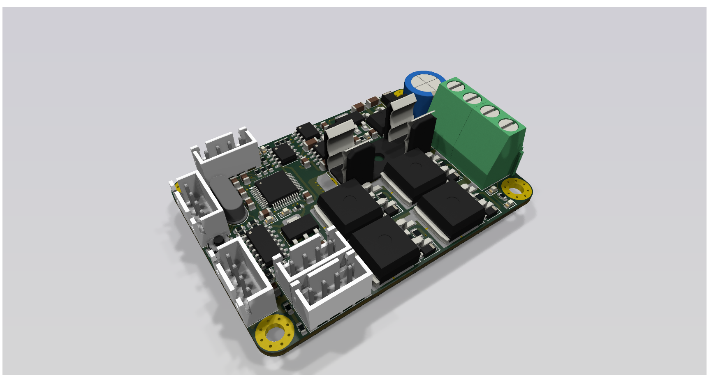
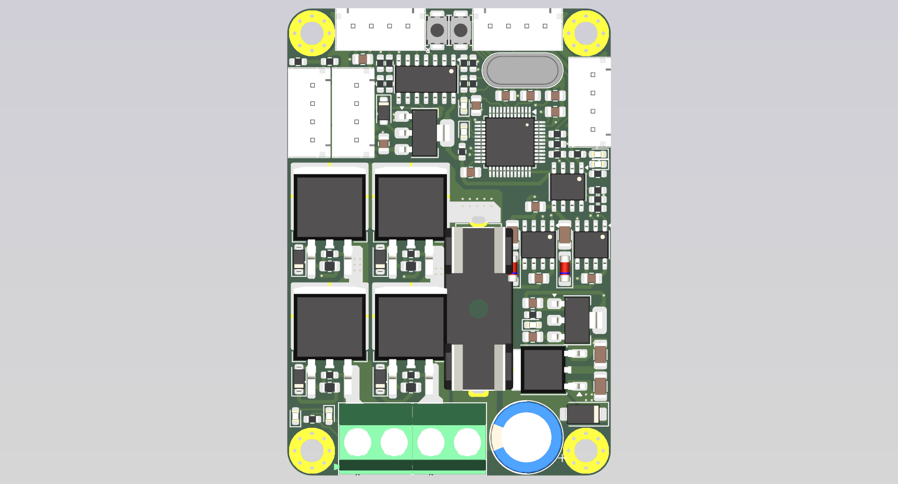
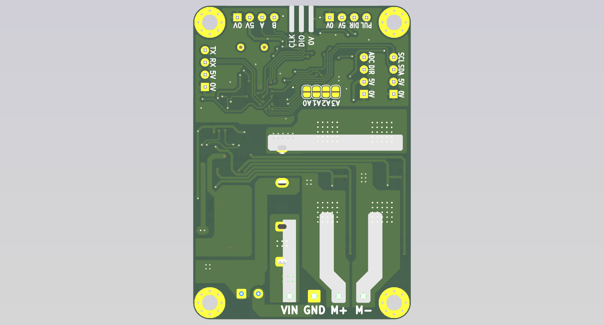

# F1_PID_Driver_V1

Mạch driver động cơ DC chổi than có điều khiển PID, thiết kế bằng **KiCad**.
Cầu H 4 × N-MOSFET, gate driver IR2184 bootstrap, cách ly quang giữa MCU và phần công suất, vi điều khiển **STM32F103C8** đọc encoder và chạy vòng PID vị trí/tốc độ.



| Mặt trên | Mặt dưới |
|---|---|
|  |  |

## Thông số chính

| Mục | Giá trị |
|---|---|
| Kích thước PCB | 45 × 65 mm, 2 lớp, đồng 1 oz |
| Điện áp động cơ (VM) | ~18 – 35 V (giới hạn bởi L7815 và tụ 50 V) |
| Dòng liên tục thực tế | ~8 – 10 A (giới hạn bởi đồng 1 oz và terminal) |
| MOSFET | 4 × IRFS4321 (TO-263, 150 V) |
| Gate driver | 2 × IR2184 (half-bridge, dead-time nội) |
| Cách ly | HCPL-0630 (2 kênh) cho PWMA/PWMB |
| MCU | STM32F103C8T6, thạch anh ngoài, SWD |
| Logic 3.3 V | AMS1117-3.3, cấp 5 V từ các cổng JST |

## Sơ đồ khối

```
 VM ──F1──┬── Cầu H (Q1–Q4 IRFS4321) ── M+ / M−
          │        ▲            ▲
          │     IR2184 (U1)  IR2184 (U2)
          │        ▲            ▲
          ├─ L7815 → +15VP → AMS1117-5.0 → +5VP
          │        │  PWMA        │ PWMB
          │   ─────┴── HCPL-0630 ─┴─────   (cách ly COM ↔ GND)
          │                ▲
 +5V (JST) → AMS1117-3.3 → STM32F103C8
                           ├─ TIM2 encoder  (PA0/PA1, qua 74x14)
                           ├─ STEP/DIR      (PA6/PA7, qua 74x14)
                           ├─ ADC biến trở  (PA3)
                           ├─ UART1 (PA9/PA10), I2C2 (PB10/PB11)
                           └─ Địa chỉ node  JP1–JP4 (PB12–PB15)
```

## Mapping chân MCU

| Chức năng | Chân | Ngoại vi |
|---|---|---|
| Encoder A/B | PA0 / PA1 | TIM2 encoder mode |
| PULSE (step) | PA6 | TIM3_CH1 |
| DIR | PA7 | GPIO |
| ADIR | PA4 | GPIO |
| Biến trở (analog) | PA3 | ADC1_IN3 |
| PWMA / PWMB | PB6 / PB7 | TIM4_CH1 / CH2 → opto → IR2184 |
| UART | PA9 / PA10 | USART1 |
| I2C | PB10 / PB11 | I2C2 (pull-up 4k7) |
| Địa chỉ node | PB12 – PB15 | Solder jumper xuống GND (ID 0–15) |
| Nạp/debug | PA13 / PA14 | SWD |

> Lưu ý firmware: 74x14 là Schmitt **đảo**, nên tín hiệu DIR/encoder/step bị đảo. Do dùng bootstrap, duty high-side không được giữ 100 % lâu (~95–98 % tối đa).

## Cấu trúc thư mục

| Đường dẫn | Nội dung |
|---|---|
| `F1_PID_Driver_V1.kicad_pro` | Project KiCad |
| `F1_PID_Driver_V1.kicad_sch` | Schematic |
| `F1_PID_Driver_V1.kicad_pcb` | PCB layout |
| `F1_PID_Driver_V1.pdf` | Schematic xuất PDF |
| `bom/ibom.html` | Interactive BOM (mở bằng trình duyệt) |
| `gerber_to_order/` | Gerber cho JLCPCB, PCBWay, Elecrow, FusionPCB… |
| `REVIEW_F1_PID_Driver_V1.md` | Báo cáo review thiết kế (ERC/DRC, lỗi, đề xuất V2) |

## Trạng thái

⚠️ **Bản V1 còn lỗi đã biết** — xem chi tiết trong [REVIEW_F1_PID_Driver_V1.md](REVIEW_F1_PID_Driver_V1.md). Những điểm quan trọng nhất:

- Zener D10 ở ngõ ADC lắp ngược chiều.
- AMS1117-5.0 nhận 15 V (sát/vượt abs-max).
- Thiếu tụ 10 µF ngõ ra LDO, dòng LED opto thấp (R8/R9 330 Ω).
- nSD luôn kéo lên, MCU không tắt được cầu H.
- Gerber trong `gerber_to_order/` (18/06/2026) **cũ hơn** file PCB (04/08/2026) — cần refill zone, chạy DRC và xuất lại trước khi đặt mạch.

Checklist sửa cho V1.1 nằm ở mục 6 của file review.

## Mở dự án

1. Cài [KiCad](https://www.kicad.org/) **10** trở lên (file được lưu bằng KiCad 10, bản cũ hơn không mở được).
2. Mở `F1_PID_Driver_V1.kicad_pro`.
3. Nếu thiếu thư viện/footprint, kiểm tra *Preferences → Manage Symbol/Footprint Libraries*.
